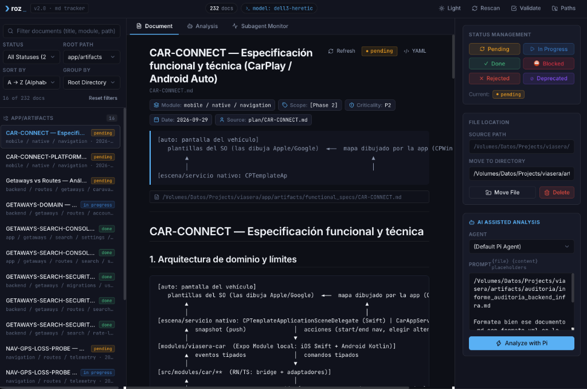
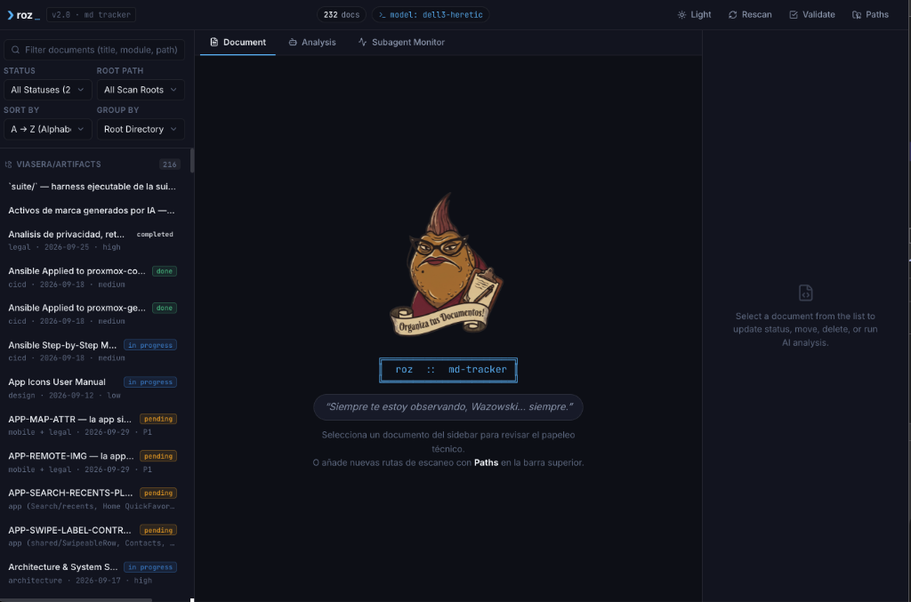
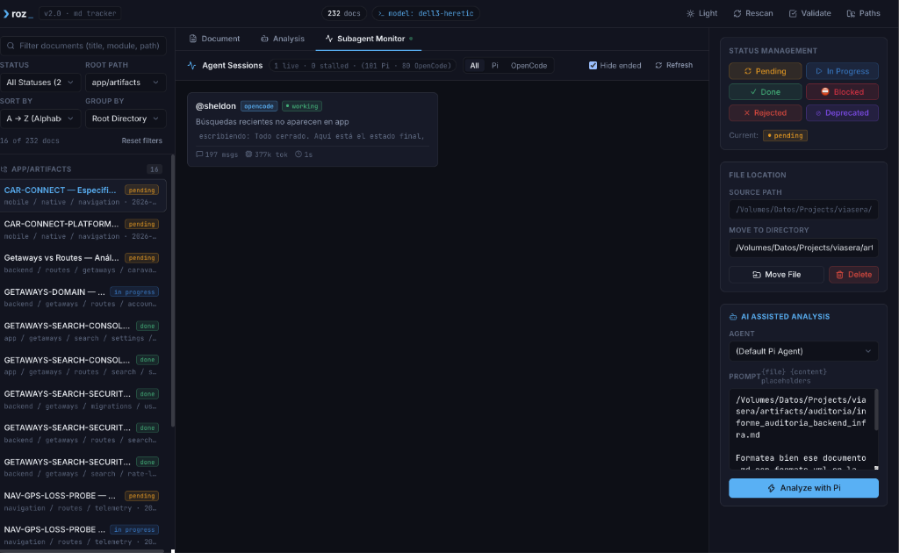

<p align="center">
  
</p>

<h1 align="center">Roz</h1>

<p align="center">
  <b>"I'm watching you, Wazowski... always watching."</b><br>
  <i>Gestión burocrática implacable de documentación técnica Markdown y torre de control para la vigilancia en tiempo real de agentes de inteligencia artificial.</i>
</p>

<p align="center">
  <a href="https://fastapi.tiangolo.com/"></a>
  <a href="https://react.dev/"></a>
  <a href="https://www.typescriptlang.org/"></a>
  <a href="https://bun.sh/"></a>
  <a href="https://vitejs.dev/"></a>
  <a href="LICENSE"></a>
</p>

---

## Overview

**Roz** es el centro de supervisión burocrático definitivo para ecosistemas de desarrollo asistido por agentes. Inspirada en la inflexible supervisora de *Monsters, Inc.*, Roz nace bajo una premisa innegociable: **ningún archivo queda sin clasificar y ningún agente trabaja en la sombra sin rendir cuentas**. En entornos modernos de ingeniería donde los agentes de IA generan planes, especificaciones, deuda técnica y auditorías a un ritmo vertiginoso, Roz impone orden, visibilidad y control estricto.

La plataforma combina un motor de escaneo inteligente multi-raíz que indexa, valida y estructura documentos `.md` (a través de metadatos YAML frontmatter y tablas de especificación) junto a una central de monitoreo de procesos para trabajadores en segundo plano (agentes y subagentes de ecosistemas como **Pi** y **OpenCode**). Desde la revisión de deuda técnica y cambios de ciclo de vida hasta la auditoría interactiva vía RPC y la supervisión de telemetría, Roz garantiza que el papeleo esté en regla y los agentes operen bajo supervisión total.

---

## What It Solves

* **Anarquía de Documentación y Especificaciones Huérfanas**: Evita que planes de arquitectura, auditorías y notas de deuda técnica queden dispersos u olvidados en árboles de directorios profundos.
* **Falta de Estandarización en Metadatos**: Extrae y valida automáticamente encabezados YAML frontmatter y esquemas tabulares (módulo, estado, prioridad, alcance, autor y fecha).
* **Agentes Desbocados y Tareas Ocultas**: Proporciona visibilidad en tiempo real de qué subagentes están ejecutándose, su consumo de tiempo, estado de actividad (`active`, `quiet`, `stalled`) y capacidad de aborto inmediato (`kill switch`).
* **Fricción en la Auditoría Interactiva**: Permite abrir sesiones interactivas de análisis con agentes vía WebSocket sin salir del navegador, respondiendo a preguntas interactivas y enviando preguntas de seguimiento (*follow-ups*).
* **Ciclo de Vida de Tareas Manual y Lento**: Facilita la transición de estados (`pending`, `active`, `done`, `rejected`, `deprecated`), el traslado organizado a carpetas de archivo y la eliminación segura de documentos obsoletos.

---

## Key Features

### Gestión y Clasificación de Documentos Markdown

<p align="center">
  
</p>

* **Escaneo Multi-Proyecto**: Configuración dinámica de múltiples rutas raíz locales simultáneas con persistencia en `localStorage`.
* **Extracción Inteligente de Metadatos**: Detección automática de variables frontmatter YAML y tablas de especificaciones técnicas (`Status`, `Priority`, `Module`, `Scope`, `Author`, `Date`).
* **Motor de Filtrado y Agrupación**:
  * Filtrado granular por estado (`active`, `pending`, `done`, `rejected`, `deprecated`, `no-status`) y por directorio raíz.
  * Agrupación flexible: por carpeta raíz, por jerarquía de subcarpetas, por módulo funcional o vista plana.
  * Ordenación por relevancia temporal, orden alfabético o severidad de estado.
* **Visor Markdown de Alto Rendimiento**: Renderizado GFM (GitHub Flavored Markdown) con resaltado de sintaxis tipado (`highlight.js`) y tabla de metadatos visuales.
* **Acciones de Ciclo de Vida**: Transición de estado con un solo clic, reubicación a directorios de cierre (ej. `done/`) y eliminación protegida por diálogo de confirmación.

### Supervisión de Trabajadores y Agentes de IA

<p align="center">
  
</p>

* **Torre de Control Multi-Proveedor**: Soporte nativo para providers de agentes (**Pi** y **OpenCode**).
* **Monitoreo de Subagentes en Vivo**:
  * Detección automática de procesos huérfanos, subagentes activos y sesiones de trabajo.
  * Clasificación visual de salud de la sesión (`active`, `quiet`, `stalled`). `stalled` = el agente mantiene el turno sin salida durante > 180 s; una sesión sin actividad durante `PI_IDLE_TTL` se reporta como `ended` (oculta por defecto).
  * Telemetría de inactividad (*idle seconds*) y tamaño de registros.
* **Inspección de Logs en Streaming**: Visualización en directo de trazas de ejecución (`tail -f`) para auditar las decisiones del agente.
* **Kill Switch Seguro**: Envío de señales de terminación controlada (`SIGTERM`) para abortar tareas que hayan entrado en bucle o consuman recursos innecesarios.

### Motores de inferencia con panel propio (adapters)
* **`kind` + `tags`**: cada manifest declara una categoría cerrada (`llm`, `voice`, `assistant`, `api`, `dashboard`, `infra`) y tags libres. El tablero filtra por categoría (chips con conteo) y por tag, y avisa cuando un filtro deja la grilla vacía.
* **`engine`**: un servicio puede declarar `"engine": "omlx" | "ollama" | "splash" | "kokoro"`. Roz carga el adapter de `server/engines/` y el modal gana pestañas propias del motor (Modelos · Config · Métricas · Logs) según lo que ese adapter soporte.
* **Kokoro (TTS)**: adapter propio porque no es un motor de inferencia con modelos descargables — su inventario son las **voces** (embeddings fijos). Expone `voices` (catálogo + default vigente), `synthesize` (prueba de voz: texto → mp3 base64 que el modal reproduce) y `set_default` (fija la voz por defecto del servicio, persistida por Kokoro en su `.env` vía `POST /admin/default-voice`). La pestaña Voces del modal es la única superficie de estas tres.
* **oMLX**: dos superficies, y la diferencia importa. Con `Authorization: Bearer <api_key>` (de `~/.omlx/config.json`) resuelve inventario y cargar/descargar de memoria (`POST /v1/models/{id}/load|unload` — el `id` de la API es corto, sin el prefijo `mlx-community/`). El resto (descargas de HuggingFace, settings globales y por modelo, logs, métricas) exige **login de admin**: `POST /admin/api/login {api_key, remember}` deja una cookie que Roz guarda en memoria y renueva sola al recibir 401. Todo secreto (`api_key`, tokens) se devuelve enmascarado.
* **oMLX · reinicio**: `omlx restart` (servicio launchd `sh.brew.omlx`). **No** se usa `POST /admin/api/server/restart`: verificado que apaga el server y el supervisor del menubar no lo levanta.
* **Ollama**: inventario (`/api/tags`), en memoria (`/api/ps`), borrado, y **`pull` con progreso** (streaming NDJSON en hilo aparte → tarea consultable). Apagarlo es cerrar la app: un `pkill` del server lo respawnea la app; encenderlo es un `launchctl kickstart`.
* **Splash**: es un **lanzador**, no un demonio. Su panel pide modelo (y flags validados contra su CLI) y Roz compone el comando, lo lanza desacoplado con pidfile y log, y lo para por PID. Puerto fijo 8038: su default no es legible ni estable.

### Sesiones de Análisis Interactivo (Pilot RPC)
* **Conexión WebSocket Bidireccional**: Streaming de razonamiento interno (*thinking stream*) y respuesta en lenguaje natural.
* **Diálogos Interactivos en UI**: Renderizado nativo de peticiones de aclaración del agente (`ask_user_question`, confirmaciones de confirmación) mediante botones y formularios.
* **Continuidad de Conversación**: Barra de mensajes interactiva para guiar al modelo mientras la sesión permanece abierta.

### Control de Servicios (Services Board)
* **Descubrimiento por Manifest**: Roz inspecciona `ROZ_SERVICES_DIR` buscando un `roz-service.json` por servicio; añadir un servicio nuevo es escribir su manifest, sin tocar código de Roz.
* **Unidades Independientes**: Un servicio puede exponer varias unidades arrancables por separado (Alfred = `Engine` + `Voice`), cada una con sus puertos, health check y comandos de arranque/parada.
* **Estado por Borde**: Verde con todas las unidades ON, ámbar con contador (`1/2 on`) si hay unidades apagadas o cargando, gris si todo está OFF.
* **Toggle Start/Stop y Restart**: Interruptor por unidad desde la tarjeta, más acciones declaradas en el manifest dentro del modal de detalle (parada y reinicio piden confirmación explícita).
* **Verificación de Identidad del Puerto**: El campo `expect` del manifest exige una cadena en el health check, de modo que un puerto ocupado por otro proceso se reporta como `port taken` en lugar de fingir un servicio sano.
* **Auto-gestión Desacoplada**: El propio Roz aparece como servicio; sus comandos se ejecutan en una sesión nueva (`detached`) para que reiniciarse no mate la petición que lo ordena.

### Skills Catalog (Skills Board)
* **Descubrimiento de solo lectura**: Roz escanea `ROZ_SKILLS_DIRS` buscando directorios con `SKILL.md` y extrae `name`, `description`, `license` y el inventario de archivos. **Nunca escribe dentro de una carpeta de skills**: el descubrimiento de Pi/OpenCode/Claude sigue intacto.
* **Taxonomía fuera del skill**: categoría, tags y el análisis del modelo viven en un índice propio de Roz (`ROZ_SKILLS_INDEX`, por defecto `.roz_skills.json`). Prioridad de autoridad: tag manual → `metadata.category` declarado en el `SKILL.md` → heurística por palabras clave sobre nombre y descripción.
* **Agrupación y filtro**: panel izquierdo con buscador, filtro por raíz de skills y grupos colapsables por tipo (Design, UX & Accessibility, Frontend & Mobile, Backend & Data, Quality & Testing, Security, Writing & Docs, Product & Planning, Legal & Compliance, Finance & Tax, Video & Media, Agents & Tooling) con conteo por grupo.
* **Ficha del skill**: frase en español de qué hace, categoría reasignable con un clic, tags, ruta, número de líneas, archivos y el `SKILL.md` completo renderizado. La `description` declarada (en inglés, escrita para el router del agente) queda detrás del toggle *Declared description (EN)*.
* **Explicación en lenguaje llano**: el botón *Explain this skill* envía el documento a un modelo OpenAI-compatible (`ROZ_LLM_*`, por defecto `dell3-heretic`) con un prompt de analista senior de documentación y streamea la respuesta: qué es, cuándo usarlo, qué resuelve, cómo se invoca, con qué no confundirlo. El contrato incluye `CATEGORY`, `TAGS` y `SUMMARY_ES` (una frase en español que pasa a ser el resumen visible del skill en la ficha y en el listado). El resultado se cachea en el índice y se marca como *out of date* cuando el `SKILL.md` cambia (`content_hash`).
* **Chat por skill**: rail derecho para preguntar lo que sea sobre el skill abierto. El modelo responde con el documento en contexto y admite explícitamente lo que el documento no define.
* **Deep dive con herramientas**: cuando hace falta investigar fuera del documento (web, GitHub, shell), el botón lanza una sesión `pi` real con el agente elegido y esa sesión aparece en la pestaña **Analysis**, reutilizando el WebSocket y los diálogos interactivos existentes.

---

## Document Format Specification

Para que Roz pueda indexar, clasificar, validar y gestionar automáticamente el ciclo de vida de los documentos Markdown (`.md`), se requiere el uso de metadatos estandarizados al inicio del archivo.

### Estándar Canónico: YAML Frontmatter

Todo documento técnico (`artifacts/`, `plan/`, especificaciones, auditorías o notas de deuda) debe comenzar con un bloque de frontmatter YAML delimitado por `---`:

```yaml
---
title: <TAG — Título descriptivo>
module: <módulo(s) afectados, ej: mobile / routes / backend / infra / backoffice>
author: <sheldon | homero | edna | tio-bob | gorgory | contador | saul | profesor | humano>
date: YYYY-MM-DD
status: Pending | In Progress | Done | Blocked | Rejected | Deprecated
priority: P0 | P1 | P2 | P3
scope: "[MVP]" | "[Phase N]" | "[Backlog]"
source: <ruta al plan/especificación de origen, ej: plan/TAG.md o tarea>
---
```

#### Diccionario de Campos y Valores Permitidos

| Campo | Tipo / Formato | Requerido | Valores Admitidos / Ejemplos |
| :--- | :--- | :---: | :--- |
| `title` | `String` | Sí | Identificador y título descriptivo (ej. `AUTH-SESSION — Refactor de tokens`) |
| `module` | `String` | Sí | Módulos afectados (ej. `mobile`, `routes`, `backend`, `infra`, `backoffice`) |
| `author` | `Enum / String` | Sí | `sheldon`, `homero`, `edna`, `tio-bob`, `gorgory`, `contador`, `saul`, `profesor`, `humano` |
| `date` | `YYYY-MM-DD` | Sí | Fecha de creación o última modificación (ej. `2026-09-30`) |
| `status` | `Enum` | Sí | `Pending`, `In Progress`, `Done`, `Blocked`, `Rejected`, `Deprecated` |
| `priority` | `Enum` | Sí | `P0` *(Crítico/Bloqueante)*, `P1` *(Alto)*, `P2` *(Medio)*, `P3` *(Bajo)* |
| `scope` | `String` | Opcional | Alcance del cambio (ej. `"[MVP]"`, `"[Phase 1]"`, `"[Phase 2]"`, `"[Backlog]"`) |
| `source` | `String` | Opcional | Origen del documento (ej. `plan/TAG.md`, `ticket #104`, `auditoría`) |

### Formato Alternativo: Tabla de Metadatos (GFM Header Table)

Roz también admite de forma retrocompatible la declaración de metadatos mediante una tabla GFM al comienzo del archivo:

```markdown
# CAR-CONNECT — Especificación funcional y técnica

| Field | Value |
| :--- | :--- |
| **Status** | Pending |
| **Priority** | P1 |
| **Module** | mobile / native |
| **Scope** | [Phase 2] |
| **Author** | sheldon |
| **Date** | 2026-09-29 |
```

> [!NOTE]
> Cuando se actualiza el estado o se realizan modificaciones desde la interfaz de Roz, el motor detecta automáticamente el formato existente en el archivo (YAML frontmatter o tabla GFM) y preserva su estructura original.

---

## Service Manifest Specification

Cada servicio que aparece en la pestaña **Services** se declara con un archivo `roz-service.json` en la raíz de su propio directorio, dentro de `ROZ_SERVICES_DIR`. Los servicios que no lo tengan pero sí expongan `start.sh` y `stop.sh` se listan como *undocumented*, sin puerto ni health check.

```json
{
  "id": "alfred",
  "name": "Alfred",
  "order": 10,
  "tags": ["voice", "assistant"],
  "url": "http://127.0.0.1:8032",
  "description": "Qué es este servicio, en dos o tres frases.",
  "docs": "README.md",
  "self": false,
  "detached": false,
  "units": [
    {
      "id": "engine",
      "name": "Engine",
      "port": 8032,
      "health": "/health",
      "expect": "\"status\"",
      "pid_file": "backend/logs/engine.pid",
      "start": "./start.sh engine",
      "stop": "./stop.sh engine"
    }
  ],
  "actions": [
    { "id": "restart-all", "label": "Restart all", "command": "./restart.sh" }
  ]
}
```

| Campo | Tipo | Requerido | Descripción |
| :--- | :--- | :---: | :--- |
| `id` | `String` | No | Identificador estable para la API. Por defecto, el nombre del directorio |
| `name` | `String` | Sí | Nombre mostrado en la tarjeta |
| `order` | `Number` | No | Orden de aparición en el tablero (menor primero, por defecto `100`) |
| `tags` | `String[]` | No | Etiquetas cortas mostradas en la tarjeta |
| `url` | `String` | No | Enlace para el botón *Open* del modal |
| `description` | `String` | No | Texto explicativo del modal |
| `docs` | `String` | No | Ruta relativa (dentro del propio servicio) a un Markdown renderizable en el modal |
| `self` | `Boolean` | No | Marca el servicio como el propio Roz: sus acciones siempre piden confirmación |
| `detached` | `Boolean` | No | Ejecuta los comandos en una sesión nueva, sin esperar salida (necesario para servicios que se reinician a sí mismos) |
| `units` | `Object[]` | Sí | Unidades arrancables por separado; como mínimo una |
| `actions` | `Object[]` | No | Comandos extra expuestos como botones en el modal |

Campos de cada unidad:

| Campo | Tipo | Requerido | Descripción |
| :--- | :--- | :---: | :--- |
| `id` | `String` | Sí | Identificador de la unidad dentro del servicio |
| `name` | `String` | Sí | Nombre mostrado en la tarjeta y en la tabla del modal |
| `port` / `ports` | `Number` / `Number[]` | No | Puerto o puertos que deben estar escuchando. Sin puertos declarados la unidad no es sondeable |
| `health` | `String` | No | Ruta (`/health`) o URL completa del health check |
| `expect` | `String` | No | Subcadena obligatoria en la respuesta del health check: si falta, la unidad se marca `port taken` |
| `pid_file` | `String` | No | Archivo con el PID: si el proceso vive pero el puerto aún no escucha, la unidad se muestra `booting` |
| `start` / `stop` | `String` | No | Comandos de arranque y parada (relativos al directorio del servicio). Con ambos definidos se habilita el reinicio |

> [!IMPORTANT]
> Los comandos se leen exclusivamente de estos manifests y se ejecutan con el directorio del servicio como `cwd`. La API **nunca** acepta una cadena de shell del cliente: sólo un `service_id`, un `unit_id` y un `action_id` conocidos. Un manifest es código — revísalo como tal.

---

## Quick Start

### Requisitos Previos
* **Python 3.10+**
* **Bun 1.1+** o **Node.js 20+**
* **Navegador moderno** (Chrome, Firefox, Safari, Arc)

### Instalación y Puesta en Marcha

1. **Clonar el repositorio**:
   ```bash
   git clone https://github.com/AdelysAlberto/roz.git
   cd roz
   ```

2. **Configurar el entorno**:
   ```bash
   cp .env.example .env   # Ajustar rutas de proyectos, host o puerto si es necesario
   ```

3. **Iniciar Roz**:
   ```bash
   ./start.sh
   ```
   *El script configurará automáticamente el entorno virtual de Python (`.venv`), instalará dependencias del backend, compilará la SPA de React con Bun si no existe `dist/` y levantará el servidor en `http://127.0.0.1:8036`.*

4. **Detener el servicio**:
   ```bash
   ./stop.sh
   ```

---

## Usage Reference / Commands

### Modo Desarrollo Frontend (Vite HMR)

Para trabajar en la interfaz de usuario con recarga rápida en caliente:

```bash
# Terminal 1: Iniciar backend FastAPI
./start.sh

# Terminal 2: Iniciar servidor de desarrollo de React
cd frontend
bun dev
# → Interfaz accesible en http://localhost:5173 con proxy automático hacia el backend
```

### Configuración de Variables de Entorno (`.env`)

| Variable | Descripción | Valor por Defecto |
| :--- | :--- | :--- |
| `ROZ_HOST` | Dirección de enlace para el servidor HTTP | `127.0.0.1` |
| `ROZ_PORT` | Puerto de escucha de la aplicación | `8036` |
| `ROZ_SERVICES_DIR` | Directorio cuyos subdirectorios se inspeccionan en busca de `roz-service.json` (pestaña Services). Vacío = tablero deshabilitado | — |
| `ROZ_SERVICE_TIMEOUT` | Segundos máximos que puede correr un comando start/stop/restart antes de ser abortado | `120` |
| `ROZ_PROJECT_ROOTS` | Rutas raíz por defecto separadas por comas | Directorio actual |
| `PI_BINARY` | Ruta al binario ejecutable de `pi` | `pi` |
| `PI_DEFAULT_MODEL` | Modelo por defecto para análisis RPC | Configuración local |
| `PI_AGENTS_DIR` | Directorio con un `<agente>.md` por agente. Cada nombre de `PI_AGENTS` se inyecta con `--append-system-prompt`; los que no tienen archivo se ocultan de la UI y avisan por el log de la sesión | — |
| `ROZ_SKILLS_DIRS` | Rutas separadas por comas con skills de agente (`<raíz>/<skill>/SKILL.md`). Vacío = pestaña Skills sin datos | — |
| `ROZ_SKILLS_INDEX` | Índice overlay de Roz (categorías, tags y análisis cacheado). Relativo al repo si no es absoluto | `.roz_skills.json` |
| `ROZ_LLM_BASE_URL` | Endpoint OpenAI-compatible usado por *Explain* y el chat de skills | — |
| `ROZ_LLM_MODEL` | Modelo de ese endpoint | — |
| `ROZ_LLM_API_KEY` | Token Bearer del endpoint (vacío si es local sin auth) | — |
| `ROZ_LLM_TIMEOUT` | Segundos máximos por llamada al modelo | `240` |
| `ROZ_LLM_MAX_SKILL_CHARS` | Tope de caracteres del `SKILL.md` enviado al modelo | `120000` |

### Endpoints Principales del Backend

* `GET /api/documents?roots=...`: Devuelve la lista indexada de documentos con metadatos y frontmatter.
* `GET /api/document?path=...`: Obtiene el contenido Markdown íntegro de un archivo.
* `POST /api/document/status`: Actualiza el estado en el frontmatter del archivo.
* `POST /api/document/move`: Traslada un documento a un nuevo directorio de destino.
* `DELETE /api/document?path=...`: Elimina el documento tras confirmación.
* `GET /api/sessions`: Devuelve las sesiones y subagentes en ejecución detectados por los proveedores.
* `GET /api/sessions/log?path=...`: Devuelve las últimas líneas del registro de un agente.
* `POST /api/sessions/kill`: Envía señal de terminación al subagente seleccionado.
* `GET /api/services`: Instantánea del tablero (servicios, unidades, estado, PIDs, health y acciones disponibles).
* `GET /api/services/docs?id=...`: Contenido del documento declarado en `docs` del manifest (lectura confinada al directorio del servicio).
* `POST /api/services/action`: Ejecuta `start`/`stop`/`restart` sobre una unidad o una acción del manifest. El comando siempre se resuelve en el servidor desde el manifest; el cliente nunca envía una cadena de shell.
* `GET /api/engines/{id}/models`: Inventario del motor (oMLX/Ollama) con estado en memoria, tamaño, tipo y contexto.
* `POST /api/engines/{id}/models/action`: `load` / `unload` (oMLX) o `delete` (Ollama) de un modelo.
* `GET|POST /api/engines/{id}/settings`: Settings globales del motor (oMLX: agrupados por sección, secretos enmascarados) y su actualización.
* `GET /api/engines/{id}/hf/search` · `POST /api/engines/{id}/hf/download` · `GET /api/engines/{id}/tasks`: Búsqueda y descarga de modelos desde HuggingFace con seguimiento de tareas.
* `POST /api/engines/{id}/pull`: Descarga con progreso para Ollama.
* `POST /api/engines/{id}/launch` · `POST /api/engines/{id}/server`: Arranque por modelo (Splash) y ciclo de vida gestionado por otro supervisor (Ollama).
* `GET /api/engines/{id}/metrics` · `GET /api/engines/{id}/logs` · `POST /api/engines/{id}/restart`: Métricas, logs y reinicio seguro del motor.
* `GET /api/skills`: Instantánea del catálogo (skills con categoría efectiva, grupos con conteo, raíces, entradas huérfanas y estado del LLM).
* `GET /api/skills/detail?id=...`: `SKILL.md` completo e inventario de archivos del skill.
* `POST /api/skills/tags`: Reasigna categoría y/o tags en el índice overlay (nunca en el `SKILL.md`).
* `POST /api/skills/analyze`: Explicación del skill en streaming SSE; persiste el resultado, la categoría y los tags al terminar.
* `POST /api/skills/chat`: Chat SSE con el `SKILL.md` como contexto.
* `POST /api/skills/deepdive`: Lanza una sesión `pi` (con herramientas) contra el skill y devuelve el `run_id` que consume la pestaña Analysis.
* `WS /ws/analyze`: Canal WebSocket para streaming de análisis y ejecución de herramientas interactivas.

---

## Repository Architecture

```text
roz/
├── .env.example              # Plantilla de configuración de entorno
├── start.sh                  # Orquestador de arranque (venv + build + uvicorn)
├── stop.sh                   # Detención limpia mediante PID (.roz.pid)
│
├── docs/                     # Recursos de documentación y capturas
│   └── screenshots/          # Vistas de la aplicación y flujos de trabajo
│
├── server/                   # Backend FastAPI
│   ├── app.py                # Router API REST, WebSocket y hosting de SPA estática
│   ├── mdstore.py            # Parser de frontmatter YAML, tablas GFM y operaciones de archivo
│   ├── monitor.py            # Orquestador de sesiones de trabajo y subagentes
│   ├── pilot.py              # Puente interactivo RPC bidireccional con pi
│   ├── services.py           # Registro de servicios: descubrimiento y validación de manifests
│   ├── services_runtime.py   # Sondeo de puertos, PIDs y health checks por unidad
│   ├── services_actions.py   # Ejecución de comandos resueltos en servidor (start/stop/restart)
│   ├── services_api.py       # Endpoints del tablero de servicios
│   └── providers/            # Adaptadores de agentes
│       ├── base.py           # Interfaz base de proveedor de ejecución
│       ├── pi_provider.py    # Integración con el ecosistema de agentes Pi
│       └── opencode_provider.py # Integración con sesiones y logs de OpenCode
│
└── frontend/                 # SPA React 19 + TypeScript + Bun + Vite
    ├── src/
    │   ├── components/
    │   │   ├── layout/       # Layout principal, cabecera de estado y pestañas
    │   │   └── ui/           # Sistema de diseño (Badge, Button, Input, Modal, Select)
    │   ├── features/
    │   │   ├── actions/      # Mutaciones de estado, archivado y eliminación
    │   │   ├── analysis/     # Visor de streaming WebSocket, thinking y follow-ups
    │   │   ├── documents/    # Visor Markdown, barra lateral, árboles y filtros
    │   │   ├── monitor/      # Tablero de supervisión de agentes, logs y kill switch
    │   │   ├── paths/        # Selector y gestor dinámico de rutas raíz
    │   │   ├── services/     # Tablero de control de servicios, tarjetas y modal de detalle
    │   │   └── validation/   # Validación de adherencia a esquemas de metadatos
    │   ├── services/         # Clientes de consulta tipados con TanStack Query
    │   ├── stores/           # Almacén de estado global con Zustand 5
    │   └── styles/           # Tokens CSS de tema claro/oscuro y estilos de lectura
    └── package.json          # Dependencias y scripts de compilación
```

---

## Author & Maintenance

Desarrollado y mantenido por **Adelys Alberto Belen**:

* **GitHub**: [@AdelysAlberto](https://github.com/AdelysAlberto)
* **Web**: [adalbeca.com](https://adalbeca.com)
* **Contacto**: `dev@adalbeca.com`

---

## License

Este proyecto está licenciado bajo los términos de la Licencia MIT. Consulta el archivo [LICENSE](LICENSE) para más información.
